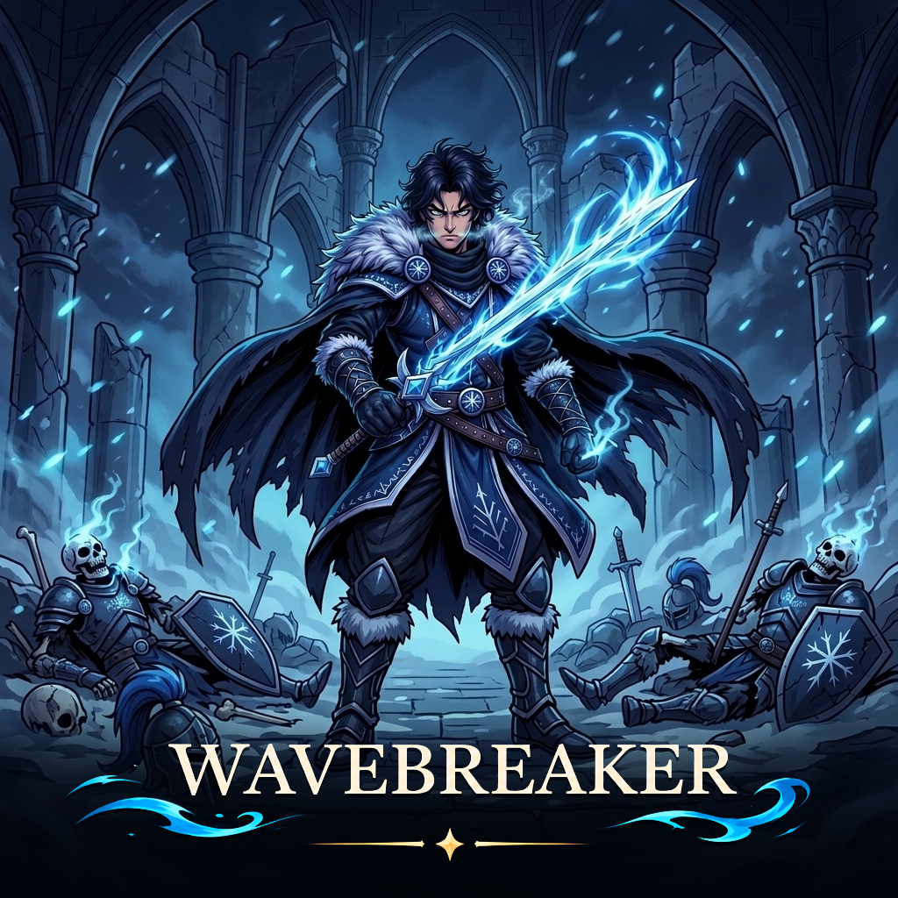

# Wavebreaker

  

  <strong><a href="https://tenacity-works.github.io/Wavebreaker/">🌐 Official Promotional Website</a></strong>
  &nbsp;•&nbsp;
  <strong><a href="https://github.com/Tenacity-Works/Wavebreaker/releases/latest">⬇ Download Windows Playtest (.zip)</a></strong>

**Wavebreaker** is a 2D action-survival roguelite developed and published by **TenacityWorks**, built in **Unity 6 (6000.6.7f1)** and starring **8 distinct champions** across **4 handcrafted 15-minute stages**. Aim manually or toggle lock-on **Auto-Aim**, weave through escalating hordes and telegraphed boss attacks, collect XP and rare battlefield consumables, bind and **Awaken** character-specific weapon runes, and spend banked gold on **Tier I & Tier II Permanent Power Ups**.

---

## Download & Play (Windows — No Unity Required)

> - **🌐 Promotional Showcase:** **[https://tenacity-works.github.io/Wavebreaker/](https://tenacity-works.github.io/Wavebreaker/)**
> - **⬇ Windows Playtest Download:** **[Download Latest `Wavebreaker-Windows.zip` from Releases](https://github.com/Tenacity-Works/Wavebreaker/releases/latest)**
>
> 1. Click the Releases link above and download **`Wavebreaker-Windows.zip`** under **Assets** *(do not use the green `<> Code` button—that downloads the Unity source project)*.
> 2. **Extract All** from the `.zip` folder so `Wavebreaker.exe` stays next to `Wavebreaker_Data/`, `UnityPlayer.dll`, and `MonoBleedingEdge/`.
> 3. Run **`Wavebreaker.exe`** *(if Windows SmartScreen shows "Windows protected your PC", click **More info → Run anyway**)*.

---

## Unity Editor & Architecture

- **Unity Editor:** Open the project in Unity **6000.6.7f1**, open `Assets/Wavebreaker/Scenes/CourtOfThePrince.unity`, and press **Play** (the **Wavebreaker** Editor menu and `Temp/WavebreakerCommand.txt` automation bridge can also prepare the scene or rebuild `Builds/Windows/Wavebreaker.exe`).
- **Animated Main Menu:** Opens on a live multi-layered wallpaper (`CourtTitleWallpaper.cs`) featuring moonlit crossfading vistas of all four realms, counter-rotating golden astrolabe rings behind the **WAVEBREAKER** crest, surging multi-plane corner waves, scrolling twilight aurora bands, and drifting elemental motes.

### Controls

All 15 controls can be rebound in **Options / Settings** (conflict assignments swap automatically and save locally):

| Default Input | Action |
| :--- | :--- |
| `W A S D` | Move |
| `Left Mouse` (click or hold) | Aim and attack toward the high-contrast custom reticle |
| `Right Mouse` | **Dash** toward cursor (*Chiori — Swift as the Wind*) |
| `E` | Unleash **Ultimate** ability (at `100` Mana) |
| `F` | Toggle **Auto-Aim** (locks onto nearest living enemy and auto-attacks) |
| `Tab` | Toggle **Attributes & Extended Ultimate Description** panel |
| `1` / `2` / `3` (or click) | Select level-up attribute or rune card |
| `R` | **Reroll** current upgrade or rune choices (when Rerolls are available) |
| `M` | Open / close paused **Full-Screen Stage Map** |
| `N` | Mute / unmute audio |
| `Escape` | Pause / resume / back |
| `F11` or `Alt + Enter` | Toggle borderless fullscreen / resizable windowed mode |

---

## Stages & Progression

Each stage is a `120 × 67.5`-unit arena rendered through a high-density four-quadrant reconstruction shader (`CourtTerrain.shader`) with obstacle collisions, **5 Silver Chests** (`+1` full level while preserving current XP progress) and **12 Bronze Chests** (scaled gold or XP). Stages survived for the full **15:00** display a **CLEARED** badge on Stage Selection and award `+250` bonus completion gold.

1. **Court of the Prince** *(Unlocked from the start)*
   - Moonlit fallen royal ruins, pine clearings, bridges, and ponds.
   - **Enemies:** Skeleton Knight, Armored Knight, Skeleton Guard (spears), Frost Knight (ice fans), **Knight Commander** minibosses (from `1:30`, every `60s`), and **The Frozen Sovereign** final boss at `13:00`.
   - **15:00 Clear Reward:** Permanently unlocks **Verdant Wilds**.

2. **Verdant Wilds** *(Unlock: Survive 15 minutes in Court of the Prince)*
   - High-detail emerald canopy, mossy clearings, ferns, and ancient trees (`ForestHDNW/NE/SW/SE`).
   - **Enemies:** Goblin Scout, Slinger (stones), Spearman, Brute, Shaman (hex fans), **Brute Champion** & **Shaman** miniboss waves (from `1:30`, every `60s`), and **The Warchief** final boss at `13:00`.
   - **15:00 Clear Reward:** Permanently unlocks **Frostpalm Reach**.

3. **Frostpalm Reach** *(Unlock: Survive 15 minutes in Verdant Wilds)*
   - Snow-covered roads winding through frosted palm groves and **8 colliding frozen lakes** (`FrostpalmNW/NE/SW/SE`).
   - **Enemies:** 8-rank Frost Legion (including Snow Archers, Frost Wolves, Ice Golems, Snow Sorcerers, Yeti Brutes, and Frost Knights). Melee miniboss waves arrive every `45s` (scaling to 2 champions at `6:00` and 3 at `12:00`), culminating in **The Frost King** at `13:00`.
   - **15:00 Clear Reward:** Permanently unlocks **Celestial Sanctum** and **Tier II Permanent Power Ups** (Ranks `6–10`).

4. **Celestial Sanctum** *(Unlock: Survive 15 minutes in Frostpalm Reach)*
   - Golden marble courtyards adorned with **8 winged angel statues** and **8 cascading turquoise waterfalls** (`TempleNW/NE/SW/SE`).
   - **Enemies:** 8-rank Celestial Host — *Halo Wisp*, *Argent Lion*, *Hollow Knight*, *Astral Hippogriff*, *Oracle Priest* (radiant star bolts), *Seraph Lion*, *Pegasus Lancer*, and **The Empyrean Archon** final boss at `13:00`. Miniboss waves arrive every `42s` (2 champions from `5:00`, 3 from `12:00`).

### Dynamic Combat Encounters & Consumables

- **Telegraphed Final Bosses & Boss Health Bar (`CourtBossAttacks.cs`):** Final bosses display a dedicated top **Boss Health Bar** and execute telegraphed special attacks with red ground warning zones—**Line Charge**, **Arcane Ground Circles**, and **Radial Ground Slam**.
- **Encirclement Waves & Controlled Chargers:** At `4:00`, `8:00`, and `12:00`, an **Encirclement** ring surrounds the player. Select fast melee enemies have a capped chance after `1:00` to spawn as **Chargers** with wind-up dash telegraphs.
- **Rare Battlefield Consumables (`CourtConsumables.cs`):** Enemies have a small Luck-scaled chance (`0.22%` regular, `8%` elites) to drop three consumables:
  - **Ice Cream:** Restores **30% of Maximum Health** with floating `+HP` text and an emerald/pink healing aura.
  - **Magnet:** Emits a magnetic pulse and vacuums **all XP shards and gold coins across the entire map** to the player.
  - **Bomb:** Detonates a fiery screen-wide shockwave that **instantly kills all regular enemies currently on screen** (excluding bosses and minibosses).

---

## Champions & Runes

Each champion has bespoke primary attack mechanics, a passive, an Ultimate (`0.8s` illustrated cut-in splash at `100` Mana), and **5 exclusive Weapon Runes**. During a run, **Levels 10 and 25** bind up to **2 Runes**, while **Levels 50 and 80** **Awaken** your bound runes.

### 1. Auren — *Free (Starter)*
- **Weapon:** *Winter's Requiem* (`22` DMG, `0.62s` interval, `100` HP, `2.3` Move) — Piercing crescent waves bounded to visible screen range.
- **Passive — Frostfire:** Waves apply `3s` of Frostfire damage over time.
- **Ultimate — Iceflame (`12s`):** Unleashes enlarged animated flaming waves (`1.7×` direct damage) and stronger Frostfire ticks.
- **Runes:**
  - **Twin Crescent:** Fire a 2nd angled wave *(Awaken: 3 waves)*.
  - **Whiteout:** Frostfire deaths burst and spread Frostfire *(Awaken: `2×` burst damage)*.
  - **Ascension:** Every `100` kills grants a Common upgrade to a random attribute with an overhead stat icon *(Awaken: every `75` kills)*.
  - **Soulfire:** Frostfire ticks restore Mana and Iceflame lasts `+4s` *(Awaken: `2×` Mana restored and `+8s` total bonus duration)*.
  - **Royal Reprisal:** Every 4th attack fires an 8-wave ring *(Awaken: every 3rd attack)*.

### 2. Aelinor — *500 Gold*
- **Weapon:** *Verdant Bow* (`22` DMG, `0.62s` interval, `100` HP, `2.3` Move) — High-velocity arrows with `+1` base pierce (hitting up to 2 targets by default).
- **Passive — Concentration:** Gain `+0.5%` critical chance per level (up to `100%`); critical hits deal `2×` damage.
- **Ultimate — Windrunner (`12s`):** Gain `+40%` Move Speed and `+30%` Attack Speed with swirling emerald wind ribbons.
- **Runes:**
  - **Twin Arrows:** Shoot a 2nd arrow per attack *(Awaken: `+20%` arrow damage)*.
  - **Piercing Arrows:** Unlimited enemy pierce *(Awaken: arrows return to Aelinor like a boomerang at max range)*.
  - **Ricochet:** Bounce to up to 2 additional enemies for `+7.5%` damage per bounce *(Awaken: `+1` extra bounce per `25%` Luck)*.
  - **Zephyr Momentum:** Bonus arrow damage from Move Speed; crits grant `+25%` Move Speed for `2.5s` *(Awaken: higher scaling + `+20%` Attack Speed on crit)*.
  - **Fortune's Quarry:** Bonus crit chance from Luck; crits mark foes for `+25%` arrow damage *(Awaken: stronger Luck crit scaling + marked kills fire 3 arrows outward)*.

### 3. Cyrene — *750 Gold*
- **Weapon:** *Glacial Scepter* (`24` DMG, `0.72s` interval, `100` HP, `2.3` Move) — Charged ice bolts that detonate in a `1.15`-unit AoE blast on impact.
- **Passive — Frostbite:** Hits apply `10%` stacking slow (up to `50%` at 5 stacks, `5s` refreshable duration).
- **Ultimate — Absolute Zero (`8s`):** Summons a cursor-targeted blizzard that freezes enemies for `2s` on first entry and deals periodic AoE Frostbite damage.
- **Runes:**
  - **Glacial Bloom:** `+30%` basic explosion area *(Awaken: also gains `+15%` area per `5` Damage above base)*.
  - **Gathering Storm:** Self-centered blizzard ticks `2×` faster and grows over time *(Awaken: blocks enemy projectiles inside Absolute Zero)*.
  - **Twin Shards:** Fire 2 ice bolts at neighboring angles *(Awaken: `+7%` damage per Frostbite stack on target, up to `+35%`)*.
  - **Shatterpoint:** Hitting a `5`-stack target triggers Frost Shatter (`1s` freeze + AoE burst) *(Awaken: triggers at `4` stacks with higher AoE damage)*.
  - **Rime Conduit:** Applying Frostbite restores Mana; blasts scale up to `+25%` with current Mana *(Awaken: `2×` Mana per Frostbite + `25` Mana refunded when Absolute Zero ends)*.

### 4. Caraxx — *1,000 Gold*
- **Weapon:** *Dragonfang Greatsword* (`30` DMG, `0.72s` interval, `100` HP, `2.3` Move) — Sweeping `180°` crimson melee cleave (`3.125` base radius).
- **Passive — Dragonscales:** Flat `20%` incoming damage reduction and `+0.1 HP/s` per level (up to `+5 HP/s`).
- **Ultimate — Fury of the Dragon Warrior (`10s`):** Spins continuously in a `360°` crimson vortex at `3×` attack speed with `+10%` Move Speed.
- **Runes:**
  - **Blood Reforge:** `-40%` Max Health, `+5 HP/s`, and `+12%` Area per `1 HP/s` of regeneration *(Awaken: `+7.5 HP/s`)*.
  - **Inferno Reach:** `+20%` ultimate spin radius *(Awaken: spinning blade blocks hostile projectiles)*.
  - **Dragon Guard:** `+20%` extra damage reduction during ultimate *(Awaken: spin damage gains `+1.5` per point of Armor)*.
  - **Colossal Cleave:** Swings and spins gain bonus damage equal to `+8%` of Max Health *(Awaken: `+12%` Max Health scaling + basic swings knock enemies back)*.
  - **Iron Juggernaut:** Taking damage unleashes an Armor-scaling shockwave *(Awaken: also triggers every 4th basic swing)*.

### 5. Elys — *1,250 Gold*
- **Weapon:** *Sunfire Blade* (`22` DMG, `0.65s` interval, `100` HP, `2.3` Move) — Piercing solar fire waves with updated base idle & swing poses.
- **Passive — Blazing Courage:** Waves apply `3s` Sunburn; burning enemies explode on death, chaining through other burning foes.
- **Ultimate — Wrath of the Sun (`10s`):** Gain `+20%` Attack Speed, `+2 HP/s`, and unleash larger `1.5×` damage blazing waves.
- **Runes:**
  - **Scorched Earth:** Blazing waves leave `3s` burning ground trails *(Awaken: `5s` duration and increased tick damage)*.
  - **Solar Echo:** Fire a 2nd wave directly behind Elys *(Awaken: `+20%` damage on both waves)*.
  - **Courageous Heart:** `+25%` damage to enemies within `3` units *(Awaken: nearby enemy deaths have a `10%` chance to heal `10` HP)*.
  - **Supernova Chain:** `+25%` death-explosion radius and explosions spread Sunburn *(Awaken: explosion damage rises from `35%` to `55%` and restores `1.5` Mana)*.
  - **Radiant Presence:** Permanent solar burn aura equal to `80%` of Magnet scaling with Damage and Regen *(Awaken: `100%` of Magnet radius + `25%` enemy slow)*.

### 6. Lilith — *1,500 Gold*
- **Weapon:** *Sovereign's Heart* (`23` DMG, `0.68s` interval, `100` HP, `2.3` Move) — High-contrast violet soul bolts that detonate in a purple AoE splash on impact.
- **Passive — Soulstealer:** Every `100` kills permanently grants `+10` Max Health with a bright purple body shine.
- **Ultimate — Devourer's Ritual (`8s`):** Summons a cursor-targeted rune ellipse (with `1:1` visual-matched ellipse hitbox) that drains foes every `0.5s`, healing `1` HP per enemy hit (up to `5` HP/tick).
- **Runes:**
  - **Blood Tithe:** Soul bolts gain `+5%` Max Health damage and `1` HP lifesteal (`0.25s` CD), locking Regen upgrades *(Awaken: `+9%` Max Health damage + pierce up to `4` foes)*.
  - **Soul Harvest:** Soulstealer triggers every `60` kills and heals `10%` Max HP *(Awaken: `+8%` Attack Speed & `+8%` Area per `100` bonus Max HP)*.
  - **Abyssal Tether:** `+25%` ritual radius, pulls foes inward, and increases their damage taken by `+20%` *(Awaken: `+4s` ritual duration and `10` HP/tick heal cap)*.
  - **Crimson Overflow:** Overhealing charges a Soul Nova (`30%` Max HP AoE every `25` excess HP) *(Awaken: restores Mana and triggers every `18` excess HP)*.
  - **Twin Phantoms:** Fire `2` homing soul bolts (`70%` damage each) *(Awaken: enemies dying inside Devourer's Ritual can spawn free homing bolts)*.

### 7. Danny — *1,750 Gold*
- **Weapon:** *Stormweaver* (`22` base DMG, `0.16s` rapid pulse interval, `100` HP, `2.3` Move) — Hold attack to channel a continuous lightning beam (`40%` movement slow while channeling unless *Overcharge* is bound).
- **Passive — Static Shock:** Lightning chains at `66%` damage to `2` nearby foes (`+1` chain target per `+50%` Area).
- **Ultimate — God of Lightning (`10s`):** Gain `+25%` Move Speed while each held lightning tick compounds damage by `+3%` per tick.
- **Runes:**
  - **Storm Conductor:** Chain lightning deals `85%` damage *(Awaken: primary and chained hits stun enemies for `1.5s`, `5s` per-enemy CD)*.
  - **Overcharge:** Removes the `40%` channeling movement penalty *(Awaken: `+10%` Move Speed and `10%` shock slow on hit)*.
  - **Thunderclap:** Lightning kills trigger an electrical AoE blast *(Awaken: every 10th primary hit also blasts surviving targets)*.
  - **Living Circuit:** `15%` damage reduction while channeling *(Awaken: `25%` reduction + heal `1%` Max HP every 20 primary hits)*.
  - **Endless Tempest:** God of Lightning lasts `30%` longer *(Awaken: `+4%` ramp per tick and `1s` grace window on release)*.

### 8. Chiori — *2,000 Gold*
- **Weapon:** *Sakura's Edge* (`24` DMG, `0.55s` interval, `90` HP, `2.65` Move) — Swift circular katana slashes around Chiori.
- **Passive — Swift as the Wind:** Right-click to dash `3.2` units toward the cursor (`3s` cooldown; orbiting cherry petals indicate readiness).
- **Ultimate — Final Slash (Instant):** Blink up to `10` units toward the cursor, slicing all enemies along the path for `350%` basic attack damage.
- **Runes:**
  - **Tailwind:** Dashing fires `3` ninja stars at nearby foes *(Awaken: dash cooldown reduced from `3s` to `2s`)*.
  - **Iaijutsu:** Next basic attack within `2s` after dashing deals `+45%` damage *(Awaken: also gains `+25%` slash radius)*.
  - **Petalwake:** Dashes leave a `2s` damaging sakura petal trail *(Awaken: `3s` trail that slows enemies by `25%`)*.
  - **Windguard:** Dashing grants `15%` damage reduction for `2s` *(Awaken: `25%` reduction + heals `3%` Max HP on a `6s` CD)*.
  - **Echo of the Final Slash:** `+30%` wider Final Slash path *(Awaken: an afterimage strikes the path again `1s` later for `50%` damage)*.

---

## In-Run Upgrades & Permanent Power Ups

- **Level-Up Rarities & Luck:** Ordinary levels offer 3 of 12 attributes (*Max Health `+20`*, *Attack Speed `+10%`*, *Damage `+5`*, *Move Speed `+0.3`*, *Regen `+0.25 HP/s`*, *Armor `+2`*, *Area `+20%`*, *XP Gain `+6%`*, *Luck `+7.5%`*, *Gold Gain `+10%`*, *Magnet `+0.15`*, *Mana `+12%`*) rolled across **Common (`100%`)**, **Rare (`125%`)**, **Epic (`150%`)**, and **Mythical (`200%`)** potencies.
- **14 Permanent Power Ups (`CourtPowerUps.cs`):**
  - **Tier I & Tier II Attributes:** All 12 core stats have **5 ranks in Tier I**, expanding to **10 ranks in Tier II** permanently upon surviving **Frostpalm Reach**, with exponential rank pricing (`base × 1.68^rank`).
  - **Revival (`2,500` Gold, 1 Rank):** Opens an interactive **Revive Prompt** upon death—reviving triggers a golden **Resurrection Light Explosion**, restores `50%` Max HP with `3s` invulnerability, knocks back nearby foes, and clears nearby projectiles (or lets you bank gold and end the run).
  - **Reroll (`400` Base Gold, up to 10 Ranks):** Grants up to `10` in-run rerolls (`[ R ]` or button) for attribute and rune selections.
  - **Toggle & Full Refund:** Any owned Power Up can be toggled **Enabled / Disabled** via checkbox without losing ranks, or refunded in full with **Refund All**.

---

## Project Structure

- `Assets/Wavebreaker/Scripts/CourtGame.cs` — Core game loop, spawning, drops, tightened torso/body hitboxes, magnet ring, auto-aim, and run state.
- `Assets/Wavebreaker/Scripts/SurvivorData.cs` — `CharacterDefinition`, `RunStats`, and all 40 `Rune` definitions & descriptions.
- `Assets/Wavebreaker/Scripts/CourtAelinor.cs`, `CourtCyrene.cs`, `CourtCaraxx.cs`, `CourtElys.cs`, `CourtLilith.cs`, `CourtDanny.cs`, `CourtChiori.cs` — Character-specific weapons, passives, ultimates, and rune mechanics.
- `Assets/Wavebreaker/Scripts/CourtStages.cs`, `CourtSnowStage.cs`, `CourtTempleStage.cs`, `ForestEnemies.cs`, `FrostpalmEnemies.cs`, `CelestialEnemies.cs` — Stage loaders, collision geometry, and stage-specific enemy rosters.
- `Assets/Wavebreaker/Scripts/CourtBossAttacks.cs` — Telegraphed final boss charge, arcane circle, and slam attacks.
- `Assets/Wavebreaker/Scripts/CourtConsumables.cs` — Rare Ice Cream, Magnet, and Bomb drops and pickup VFX.
- `Assets/Wavebreaker/Scripts/CourtPowerUps.cs` & `PowerUpIcons.cs` — Tier I/II permanent upgrades, Revival prompt/VFX, Rerolls, toggles, and pixel icons.
- `Assets/Wavebreaker/Scripts/CourtTitleWallpaper.cs`, `CourtMenus.cs`, `CourtRoster.cs`, `CourtUI.cs` — Animated main menu wallpaper, stage/character selection, extended `TAB` ultimate HUD, boss HP bar, custom reticle, and run summary screen.
- `Assets/Wavebreaker/Shaders/CourtTerrain.shader` & `KeyedSprite.shader` — High-density quadrant terrain reconstruction and URP sprite/flame shaders.
